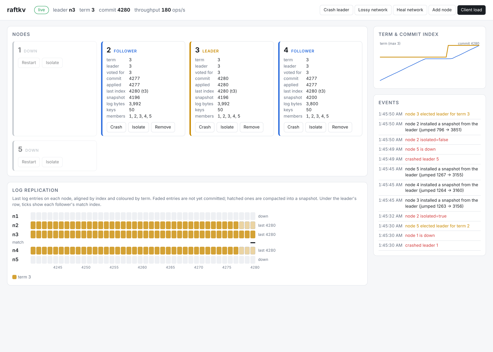

# raftkv

A distributed, linearizable key-value store in Go. It is built on a from-scratch implementation of the Raft consensus algorithm; no Raft libraries are used. It also includes a deterministic simulation harness that crashes, partitions and garbles the network, then checks every recorded history for linearizability.



*Live dashboard in demo mode: node 1 (the old leader) was crashed, and node 5 won term 2. Node 2 is isolated: thanks to Pre-Vote it keeps retrying without inflating its term, and it is 440 entries behind.*

## What's inside

| | |
|---|---|
| **Raft** (`raft/`) | Leader election, log replication with fast conflict backoff, persistence, snapshots with InstallSnapshot, and log compaction. Also Pre-Vote, check-quorum, vote leases, and single-server membership changes. The core is a deterministic, single-threaded state machine. |
| **Storage** (`raft/filestorage.go`) | CRC-checked write-ahead log plus an atomic snapshot file. Every write is fsynced. A torn tail is detected and dropped. |
| **KV service** (`kv/`, `rsm/`, `server/`) | Get/Put/Append/Delete over gRPC. Reads use ReadIndex: linearizable, and they skip the log, so a read needs no log append and no fsync. Per-client sessions (client ID and sequence number) give retried writes exactly-once semantics. |
| **Client** (`client/`) | Tracks the leader, follows hints, retries with backoff, and reuses the same `(id, seq)` on every retry. |
| **Simulator** (`sim/`) | Runs a whole cluster plus clients in one goroutine on a virtual clock. The network drops, delays, duplicates and reorders messages, partitions nodes, and crashes and restarts them. Membership churn and a leader killer are also available. Everything is seeded and bit-for-bit reproducible. |
| **Linearizability checker** (`linearize/`) | Porcupine-style: the Wing & Gong search with Lowe's memoisation, partitioned per key. |
| **Benchmarks** (`cmd/raftkv-bench`) | Throughput and latency vs cluster size and under faults, on the real gRPC stack. See [docs/BENCHMARKS.md](docs/BENCHMARKS.md). |
| **Dashboard** (`dashboard/`) | Live view of roles, terms, per-node log strips coloured by term, commit and snapshot markers, and leader match indexes. Demo mode adds fault buttons. |
| **Stretch goals** | Dynamic membership (add/remove servers live). A sharded multi-group store with a Raft-replicated shard controller and shard migration (`shard/`). |

## Quick start

```bash
go build -o bin/ ./cmd/...
```

The quickest way to see it working is the dashboard demo. It runs a 5-node cluster in-process with client load:

```bash
./bin/raftkv-dashboard -listen :8080 -demo 5
```

Open http://localhost:8080, then crash the leader, isolate nodes, make the network lossy, or add and remove servers.

To run a real 3-node cluster as separate processes:

```bash
P=1=localhost:7001,2=localhost:7002,3=localhost:7003
./bin/raftkv-server -id 1 -addr :7001 -http :8001 -peers $P -data data/1 &
./bin/raftkv-server -id 2 -addr :7002 -http :8002 -peers $P -data data/2 &
./bin/raftkv-server -id 3 -addr :7003 -http :8003 -peers $P -data data/3 &
```

```bash
./bin/raftkv-cli put greeting hello
./bin/raftkv-cli append greeting ", world"
./bin/raftkv-cli get greeting
./bin/raftkv-cli status
```

To add a fourth server to the running cluster, start it with `-join`, then add it through the CLI:

```bash
./bin/raftkv-server -id 4 -addr :7004 -http :8004 -join -data data/4 &
```

```bash
./bin/raftkv-cli add-server 4 localhost:7004
```

To point the dashboard at the running servers instead of the demo cluster:

```bash
./bin/raftkv-dashboard -nodes http://localhost:8001/status,http://localhost:8002/status,http://localhost:8003/status
```

## Architecture

```
            client.Clerk ──gRPC KV.Do──►┌────────────── server.Node ───────────────┐
                                        │ gRPC handlers ──closures──► event loop   │
                                        │                (one goroutine)            │
                                        │   rsm.Core: Submit / Flush / callbacks   │
                                        │     │                         │           │
                                        │   raft.Raft ◄─Tick/Step─┐   kv.Store      │
                                        │     │ Flush(): persist,  │   (dedup,      │
                                        │     │ then msgs+applies  │   snapshots)   │
                                        │   FileStorage (WAL)   Transport ◄──────────┼── peer gRPC streams
                                        └──────────────────────────────────────────┘
```

The core design decision is that **`raft.Raft` performs no I/O and owns no goroutines or timers.** The caller drives it:

- `Tick()` advances the logical clock.
- `Step(msg)` delivers a message.
- `Propose(cmd)` appends a command on the leader.
- `Flush()` persists dirty state through the `Storage` interface. Only then does it return outgoing messages and newly committed entries.

Messages are therefore never released before the state they depend on is durable; this is the paper's "persist before responding" rule, enforced by the API. It also means the server batches naturally. The event loop drains every queued message and proposal, then pays one fsync for the whole batch.

The same `raft`, `rsm` and `kv` code runs in two places:

- **Production** (`server/`): wall-clock ticker, gRPC streams, `FileStorage`.
- **Simulation** (`sim/`): virtual clock, in-memory network, `MemStorage`. A crash means discarding the node object but keeping its `MemStorage`, exactly like a disk.

### Raft details and deviations from the paper

- **Election.** Randomised timeouts in [T, 2T). A new leader appends a no-op so it can commit entries from earlier terms (§5.4.2 and §8). Only current-term entries are committed by counting replicas (the "Figure 8" rule).
- **Pre-Vote** (dissertation §9.6). A node first asks whether it *could* win before bumping its term. Without it, a follower restarting after a crash deposed the healthy leader and stalled the cluster for about 650 ms (see benchmarks).
- **Vote lease** (dissertation §4.2.3). A node that heard from a leader within the minimum election timeout ignores RequestVote/PreVote. Removed or partitioned servers therefore cannot disrupt the cluster.
- **Check-quorum.** A leader that hasn't heard from a majority within an election timeout steps down, so clients stuck on a minority leader fail over quickly.
- **Log repair.** Followers reply with `(ConflictTerm, ConflictIndex)`, which lets the leader skip a whole term per round trip. Followers truncate only on a real conflict, so stale or reordered AppendEntries never discard entries.
- **Replication.** One AppendEntries is in flight per follower, with batches of up to 1024 entries. Heartbeats retransmit.
- **Snapshots.** The service snapshots once the log exceeds `MaxLogBytes`. A snapshot records its membership. InstallSnapshot sends the whole snapshot in a single message; the paper's chunked `offset` transfer is not implemented.
- **Membership changes** are single-server changes (dissertation §4.1):
  - A config entry takes effect as soon as it is appended, and is rolled back if truncated.
  - Only one change can be in flight at a time.
  - A leader must commit an entry in its own term before proposing a change. This is Ongaro's fix for the single-server bug.
  - A leader that removes itself keeps leading until the change commits, then steps down.
  - New servers join as voters immediately; there is no non-voting catch-up phase.
- **Reads use ReadIndex** (dissertation §6.4):
  - The leader records its commit index. It refuses until its own term's no-op has committed, and the read then falls back to the log.
  - It confirms leadership with an entry-less `MsgHeartbeat` round acknowledged by a majority. Every read waiting at that point shares the same round.
  - Once it has applied up to that index, it answers from local state.
  - Reads are 24–58% faster than log reads on 3 nodes (see benchmarks). Read safety does not depend on check-quorum; the simulator disables check-quorum for a third of seeds to prove it.

## Testing

```bash
go test ./...                                             # unit, integration, a few seeds
go test ./sim -run TestRandomized -seeds=5000 -v          # 5000 randomized fault runs
go test ./sim -run TestRandomized -seed=1234 -v           # replay one seed with a full trace
go test ./shard -shard-seeds=500                          # sharded deployment
```

**Deterministic simulation.** Each seed picks a cluster shape (3, 5 or 7 nodes; 3–7 clients; 1–5 keys) and a fault mix:

- crashes and restarts
- random and leader-isolating partitions
- 10% drops, 5% duplicates, and 5% long delays of up to 200 ms (which reorder messages)
- membership churn
- small AppendEntries batches
- snapshot thresholds
- with or without Pre-Vote
- a high-churn profile
- a *leader killer* that repeatedly crashes the leader faster than an election timeout (Figure-8 style)

After the chaos phase, the cluster is healed, and every pending client operation must complete. That checks liveness. The simulator also checks these during the run:

- **Election safety**: at most one leader per term.
- **State machine safety**: no two nodes apply different entries at the same index.
- **Convergence**: once healed, all members end with byte-identical KV state.

The full client history then goes to the linearizability checker. `TestDeterminism` replays seeds and compares a hash of every delivered message. On my 4-core VM a seed takes about 75 ms. In one run of 3,000 fresh seeds, there were 4 million client ops, 38k elections, 45k crashes, 25k partitions and 115k snapshot transfers, and no violations.

The checker's search is exponential in the worst case, as in Porcupine and Knossos. It happens when several long-running appends to one key overlap. So a check that exceeds `-check-timeout` (30 s) is reported as *inconclusive*, with its seed, rather than failed; only a proven violation fails the test. This affected 1 of those 3,000 seeds.

**The harness has been shown to catch real bugs.** I injected these mutations; each was caught within at most 1,000 seeds (most on the first few):

| Injected bug | Caught by |
|---|---|
| Disable request deduplication | linearizability checker (every seed) |
| Grant votes without the up-to-date log check | committed-entry truncation detected |
| Quorum off by one | committed-entry truncation detected |
| Commit previous-term entries by counting (Figure 8) | caught once the leader-killer profile was added |
| Shard migration drops the dedup table | linearizability checker |
| Serve a shard before its data arrives | liveness / linearizability |
| ReadIndex confirms reads without a quorum (stale reads from a deposed leader) | linearizability checker, once some seeds ran without check-quorum |
| Heartbeat sends the leader's full commit index instead of capping it at the follower's match | state machine safety (different entries applied at one index) |

Two mutations were *not* caught, because this design makes them nearly unreachable:

- **Follower commit bounded by `lastIndex`** instead of "index of the last new entry". The leader's no-op plus conflict-term backoff means a follower almost never keeps a stale suffix past a matching batch.
- **Serving a ReadIndex read before applying up to its index.** `rsm` applies every committed entry before it answers reads in the same step.

The correct rules are still implemented.

**Real-network integration tests** (`cluster/`). These run 5 real gRPC servers with 6 concurrent clients through leader crashes, partitions and 2% message loss. They check the wall-clock history for linearizability, and also test live add/remove of servers.

**CI** (`.github/workflows/ci.yml`):

- gofmt, vet, and the race detector
- integration tests
- the simulator sharded over 8 jobs, running 4,000 seeds on every push
- a nightly run of 20,000 *fresh* seeds

Failing seeds are uploaded as artifacts so they can be replayed locally with `-seed=N`.

## Sharded multi-group version (`shard/`)

The design follows MIT 6.5840 Lab 5.

- **Shard controller.** A Raft-replicated state machine that stores numbered configurations, each mapping 10 shards to replica groups. It supports Join, Leave, Move and Query, with deterministic minimal-move rebalancing.
- **Replica groups.** Each group is its own Raft cluster. Its leader polls the controller and moves through configurations strictly one at a time, each step committed through the group's log.
- **Shard migration:**
  - When a group gains a shard, it *pulls* it from the previous owner. The shard's per-client dedup sessions travel with its data, so exactly-once semantics survive migration.
  - The previous owner freezes the shard until then.
  - Once the new owner has installed the shard, it tells the old owner to garbage-collect it.
  - A group won't take the next configuration until all of its migrations and GCs are done.
  - Clients that reach the wrong group re-query the configuration.

It runs in its own deterministic multi-group simulator: 3 controller servers and 3 groups of 3. During the run, groups keep joining, leaving and moving shards, alongside crashes, partitions and a lossy network. Histories across all keys are checked for linearizability, in CI too. The sharded version is exercised only in the simulator; it is not wired into the gRPC server binaries.

## Repository layout

```
raft/        consensus core, MemStorage, FileStorage (WAL), unit tests
rsm/         Raft <-> state machine glue (callbacks, snapshots, leadership loss)
kv/          KV state machine with client sessions
server/      production node: event loop, gRPC transport and KV API, /status
client/      Clerk (retries, leader tracking, dedup IDs)
cluster/     in-process real cluster with fault injection + integration tests
sim/         deterministic simulator + randomized/linearizability tests
linearize/   Porcupine-style linearizability checker + KV model
shard/       shard controller, replica groups, multi-group simulator
dashboard/   live web dashboard (SSE) with demo-mode fault controls
cmd/         raftkv-server, raftkv-cli, raftkv-bench, raftkv-dashboard
proto/       protobuf/gRPC definitions (regenerate with `buf generate`)
docs/        benchmarks
```

## Limitations

- There are no lease-based reads: every read still costs one heartbeat round trip.
- InstallSnapshot is not chunked.
- New members join as voters without a catch-up phase. Adding a server to a small cluster can briefly slow commits.
- The WAL is compacted only when a snapshot is taken.
- The peer transport is plaintext gRPC with no authentication.
