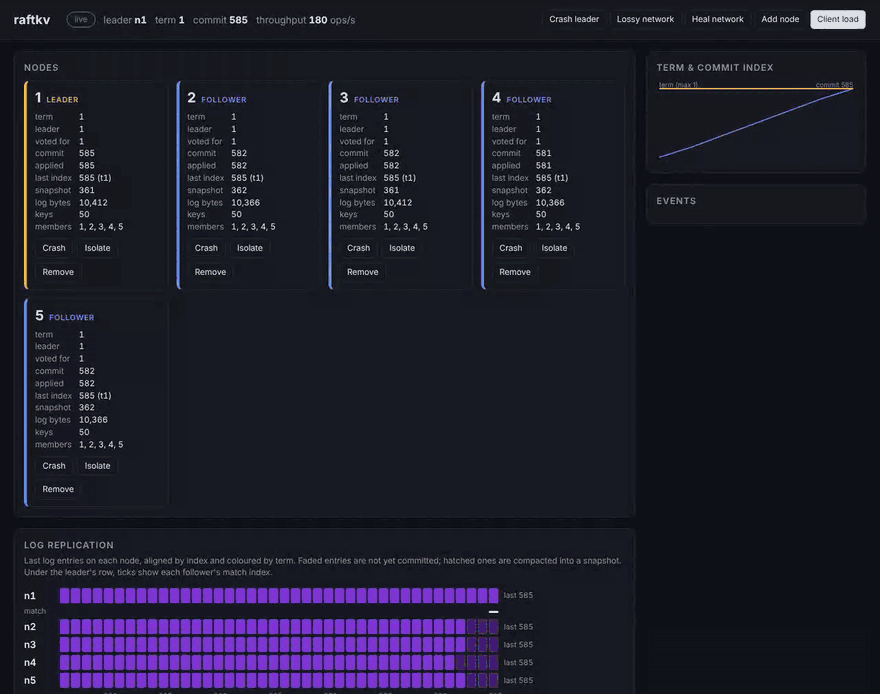

<p align="center">
  
</p>

<p align="center">
  A replicated key-value store in Go. Raft written from scratch, plus a simulator whose whole job is to break it.
</p>

<p align="center">
  <a href="#run-it">Run it</a> ·
  <a href="#how-its-tested">How it's tested</a> ·
  <a href="#numbers">Numbers</a> ·
  <a href="#inside">Inside</a> ·
  <a href="#limits">Limits</a>
</p>

<br>

The letters above are drawn the way the log fills up. Each square is an entry: it shows up hollow when the leader appends it, then fills in once a majority has it. The colour changes with each new term.

## Kill the leader

<p align="center">
  
</p>

That recording is a real session against three `raftkv-server` processes. The leader gets `kill -9`. The next read waits out one election (330 ms on this machine), then succeeds against the new leader, and so does the write after it. Nothing on the client side had to know which node was in charge.

## Watch it

<p align="center">
  
</p>

This is the dashboard in demo mode: five real servers in one process, with clients writing in the background. In the recording:

- **Crash leader:** the old leader goes grey, and a new one wins term 2 within a few hundred milliseconds.
- **Isolate:** a follower is cut off. It sits in `pre-candidate` and its log strip stops growing. Because of Pre-Vote it never bumps its term, so when the partition heals it can't depose anyone.
- **Restart and heal:** the crashed node comes back, catches up (through a snapshot if it fell far enough behind) and rejoins.

Each row in the log strip is one node's log. A cell's colour is the entry's term; faded cells aren't committed yet, and hatched ones have been folded into a snapshot.

## Run it

You need Go 1.24.

```bash
go build -o bin/ ./cmd/...
./bin/raftkv-dashboard -listen :8080 -demo 5
```

Then open http://localhost:8080 and start breaking things. The buttons do what they say.

Or run a real cluster, one process per node:

```bash
P=1=localhost:7001,2=localhost:7002,3=localhost:7003
./bin/raftkv-server -id 1 -addr :7001 -http :8001 -peers $P -data data/1 &
./bin/raftkv-server -id 2 -addr :7002 -http :8002 -peers $P -data data/2 &
./bin/raftkv-server -id 3 -addr :7003 -http :8003 -peers $P -data data/3 &
```

```bash
./bin/raftkv-cli put city lisbon
./bin/raftkv-cli get city
./bin/raftkv-cli status
```

Growing the cluster: start an empty node with `-join`, then add it. It joins as a learner that copies the log without voting, and the leader promotes it once it has caught up.

```bash
./bin/raftkv-server -id 4 -addr :7004 -http :8004 -join -data data/4 &
./bin/raftkv-cli add-server 4 localhost:7004
```

To watch real servers instead of the demo cluster, point the dashboard at their `/status` endpoints:

```bash
./bin/raftkv-dashboard -nodes http://localhost:8001/status,http://localhost:8002/status,http://localhost:8003/status
```

## How it's tested

Raft bugs hide in interleavings you'd never write a test for, so most of the testing here is a simulator. The whole cluster runs in one goroutine on a fake clock: every node, every client, and a network that drops, delays, duplicates and reorders messages. A nemesis crashes nodes, partitions them, adds and removes servers, and sometimes kills each new leader moments after it's elected. All of that comes from one seed, so any failure replays exactly, message for message.

Every run ends with the network healed. Every pending client request then has to finish. Along the way, the simulator checks:

- no term ever has two leaders
- no two nodes ever apply different entries at the same index
- after the heal, every replica ends up with byte-identical state

Finally, the complete client history goes through a Porcupine-style linearizability checker.

<p align="center">
  
</p>

Passing tests only mean something if they fail when the code is wrong, so bugs get planted on purpose and the simulator has to find them. In the recording, the leader is allowed to answer reads without checking that a majority still follows it. Seed 300024 catches it right away: client 0 reads a value, then immediately reads an *older* one, served by a leader that had already been replaced on the other side of a partition.

The planted bugs so far, and what caught each one:

| Planted bug | Caught by |
|---|---|
| Request deduplication switched off | linearizability check, every seed |
| Votes granted without the log up-to-date check | a node tried to truncate a committed entry |
| Quorum off by one | same |
| Old-term entries committed by counting replicas (the paper's Figure 8) | only after the leader-killer profile was added |
| Reads answered without confirming leadership | only after some seeds started running without check-quorum |
| Heartbeats carry the leader's full commit index | two nodes applied different entries at the same index |
| Shard migration forgets the dedup table | linearizability check |
| A shard served before its data arrives | liveness and linearizability |

Two plants survived, and both turned out to be close to unreachable in this design:

- **A follower commit bound that was too loose.** The leader's no-op and conflict-term backoff almost never leave a follower with a stale suffix for it to matter.
- **Serving a read before applying up to its read index.** Committed entries are always applied before reads are answered in the same step.

Several of those rows only turned red after the simulator was made harsher. The first version of the harness would have missed them.

The simulator has also found bugs nobody planted:

- **A restarted follower stalled the whole cluster for 650 ms.** The leader's reconnect backoff outlasted the follower's election timeout, so the follower bumped its term and deposed a healthy leader. Pre-Vote fixed it.
- **A leader that proposed its own removal and then crashed could freeze the cluster forever.** It held the newest log but refused to stand for election, and nobody else could win without its vote. Found by seed 602786. A server whose removal hasn't committed yet may now still campaign.

Each seed takes about 75 ms. In CI, every push runs 4,000 seeds split across 8 jobs, and a nightly job runs 20,000 new ones. A failing seed is saved as a build artifact so it can be replayed:

```bash
go test ./sim -run TestRandomized -seeds=3000 -v      # a batch
go test ./sim -run TestRandomized -seed=602786 -v     # one seed, full trace
go test ./cluster/                                    # real gRPC servers, real faults
```

One caveat. On pathological single-key histories, the checker's search can run for minutes, the same weakness Porcupine and Knossos have. A check that passes 30 seconds is logged as inconclusive, along with its seed, and only a proven violation fails the build. That happens on one or two seeds out of every 3,000.

## Numbers

These are from a single 4-core VM, so all nodes compete for the same CPU. Treat them as relative. The setup: 32 clients, fsync on, 128-byte values.

| nodes | 50% writes | 10% writes | median, 50% writes |
|---:|---:|---:|---:|
| 1 | 30,053 ops/s | 31,539 ops/s | 0.97 ms |
| 3 | 17,202 | 22,836 | 1.78 ms |
| 5 | 13,910 | 18,858 | 2.21 ms |
| 7 | 11,620 | 16,001 | 2.66 ms |

Under faults, on 3 to 7 nodes:

- losing the leader costs one election, about 180 to 330 ms
- isolating the leader costs about 230 to 290 ms
- crashing a follower is barely visible (under 25 ms)

Reads don't touch the log: the leader confirms it still leads with one heartbeat round, then answers locally. That is 24 to 58% faster than pushing reads through the log. The full tables, and how to reproduce them, are in [docs/BENCHMARKS.md](docs/BENCHMARKS.md).

## Inside

The Raft core (`raft/`) does no I/O. It has no goroutines, no timers and no sockets. You drive it by hand:

- `Tick()` advances its clock.
- `Step()` hands it a message.
- `Propose()` gives it a command.
- `Flush()` writes whatever changed to storage, and only *then* returns the messages to send and the entries that are ready to apply.

That one rule enforces Raft's "persist before you answer". It also means the server batches for free: it drains everything queued, pays one fsync, and sends. The same core runs under the real gRPC server and inside the simulator, which is the only reason the simulator is worth trusting.

What's implemented, against the paper and Ongaro's dissertation:

- **Elections**
  - Randomised timeouts.
  - A no-op entry from every new leader.
  - The Figure 8 commit rule.
  - Pre-Vote, so rejoining nodes don't disrupt the cluster.
  - Check-quorum, so a cut-off leader steps down.
  - Vote leases, so removed servers can't start fights.
- **Replication**
  - Followers report the conflicting term, so the leader can skip back a whole term at once.
  - Batches of up to 1024 entries.
  - Followers truncate only on a real conflict, so a stale or reordered message never throws away good entries.
- **Persistence**
  - A write-ahead log with checksummed records and fsync, plus an atomically replaced snapshot file.
  - A record half-written during a crash is detected and dropped.
- **Snapshots**
  - Taken when the log passes a size threshold.
  - Sent whole to followers that fall behind the compacted prefix.
- **Membership**
  - One server is added or removed at a time.
  - New servers join as learners and are promoted when caught up.
  - A leader that removes itself steps down once the change commits.
- **Reads**
  - ReadIndex, confirmed by an entry-less heartbeat round shared by every read waiting at that moment.
- **Clients**
  - Every request carries a client ID and sequence number, so a retried write runs exactly once, even across a leader change.

There's also a sharded version (`shard/`), after MIT 6.5840's lab 5:
- **Shard controller.** A Raft-replicated controller hands out numbered configurations that map 10 shards to replica groups.
- **Replica groups.** Each group is its own Raft cluster and moves through the configurations one at a time.
- **Migration.** A group pulls each incoming shard, together with that shard's dedup table, from the previous owner. It then tells the old owner to delete its copy.

The sharded version has its own simulator, with groups joining and leaving during crashes and partitions, and every history is checked. It isn't wired into the server binaries yet.

```
raft/        the consensus core, in-memory and on-disk storage
rsm/         glue between Raft and a state machine: callbacks, snapshots, reads
kv/          the key-value state machine and client sessions
server/      the real node: event loop, gRPC transport and API, /status
client/      the client library (leader tracking, retries, dedup)
cluster/     real servers in one process, with fault injection
sim/         the deterministic simulator and randomized tests
linearize/   the linearizability checker
shard/       shard controller, replica groups, multi-group simulator
dashboard/   the web dashboard
cmd/         raftkv-server, raftkv-cli, raftkv-bench, raftkv-dashboard
docs/        benchmarks, and the scripts that draw the images above
```

## Limits

Things it doesn't do yet:

- Snapshots go to followers as one message rather than in chunks.
- Learner promotion is a simple "caught up to commit" check, without the dissertation's timed rounds.
- The write-ahead log is only compacted when a snapshot is taken.
- Peers and clients talk over plaintext gRPC.
- Client sessions are never expired.

The images in this README are generated from real runs. To redraw them:

- terminals: `python3 docs/media/make_terminals.py`
- wordmark: `python3 docs/media/make_wordmark.py`
- dashboard: re-record the demo with Playwright and convert it with ffmpeg
